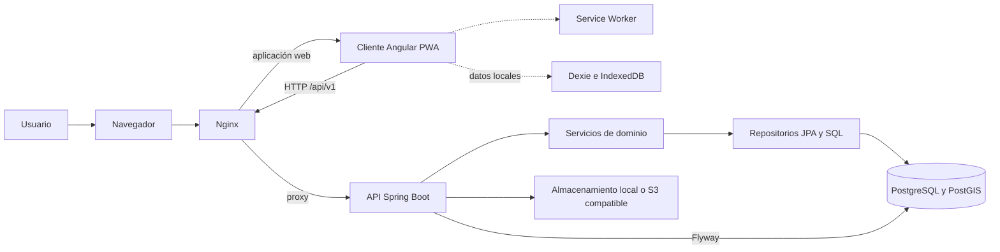

# 1. Arquitectura y modelo de datos

## Descripción

El SGP administra el inventario, las inspecciones y el mantenimiento de puentes mediante una aplicación cliente-servidor. El cliente web Angular consume una API REST Spring Boot. PostgreSQL conserva los datos del sistema; PostGIS añade soporte para ubicaciones y consultas geográficas.

## Tecnologías

| Componente | Tecnologías relevantes |
| --- | --- |
| Cliente web | Angular 21, TypeScript, RxJS y Angular Service Worker. Dexie sobre IndexedDB para datos locales offline. |
| API | Java 21, Spring Boot 3.3, Spring Web, Spring Security, Spring Data JPA, Spring Validation y MapStruct. Springdoc publica el contrato OpenAPI. |
| Persistencia | PostgreSQL 16, PostGIS y Flyway para las migraciones versionadas. Hibernate accede a los datos y valida su esquema. |
| Publicación y archivos | Nginx sirve el cliente y actúa como proxy; Docker Compose integra el entorno local. La API admite almacenamiento local o S3 compatible, incluido MinIO en desarrollo. |

## Funcionamiento

El navegador recibe la aplicación Angular desde Nginx. Las pantallas delegan las operaciones a servicios del cliente, que llaman por HTTP los endpoints funcionales bajo `/api/v1`. En el entorno desplegado, Nginx sirve la aplicación y reenvía las solicitudes `/api/` a la API; en desarrollo, el proxy de Angular las dirige al backend local.

La API aplica seguridad y validación en la frontera HTTP, delega las reglas a los servicios de dominio y accede a PostgreSQL mediante repositorios JPA o consultas SQL específicas. Los controladores intercambian DTO con el cliente; las entidades JPA permanecen dentro del backend. Los errores se devuelven en formato `ProblemDetail`, con código y detalles de validación cuando corresponde.

El backend se organiza por dominios funcionales, entre ellos usuarios, cursos, puentes, formularios, inspecciones, revisiones y mantenimiento. Cada dominio contiene las capas que necesita; `common` agrupa capacidades compartidas. El frontend se organiza en funcionalidades, con servicios para las llamadas HTTP y rutas que permiten cargar cada sección de manera diferida. `core` concentra infraestructura compartida y `offline` encapsula el almacenamiento local.

Los datos del servidor se modelan principalmente en tablas relacionales. Las entidades centrales vinculan usuarios, cursos e inscripciones con puentes y asignaciones; los puentes con inspecciones; las inspecciones con versiones de formulario, revisiones y resultados del índice de condición; y las órdenes de mantenimiento con planes, ejecuciones y evidencias. Foro, notificaciones, auditoría e idempotencia respaldan varios flujos.

El esquema también utiliza JSONB para esquemas, respuestas y configuraciones versionadas; tipos geográficos para ubicaciones y límites territoriales; e índices y restricciones para consultas e invariantes de datos. Los archivos binarios se guardan mediante el proveedor configurado, mientras la base de datos conserva sus registros y relaciones.

Flyway aplica las migraciones SQL del proyecto, actualmente desde V1 hasta V25. El navegador también puede conservar recursos de la PWA, algunos datos de referencia y datos de trabajo en IndexedDB. La sincronización offline se comunica con el backend mediante la API; IndexedDB no sustituye a la base de datos del servidor.

## Diagrama Mermaid

## Consideraciones técnicas

- Flyway gobierna la evolución del esquema. Hibernate tiene `ddl-auto=validate`: comprueba que el mapeo concuerde con la base, pero no crea ni actualiza tablas.
- Los cambios estructurales requieren nuevas migraciones; las ya aplicadas no se modifican.
- JSONB permite conservar estructuras variables, pero las solicitudes siguen sujetas a validaciones de dominio y esquema.
- Las ubicaciones y consultas espaciales dependen de PostGIS.
- Los perfiles y variables de ambiente determinan conexiones, seguridad y proveedor de archivos. La configuración disponible no confirma por sí sola qué servicios externos están desplegados.
