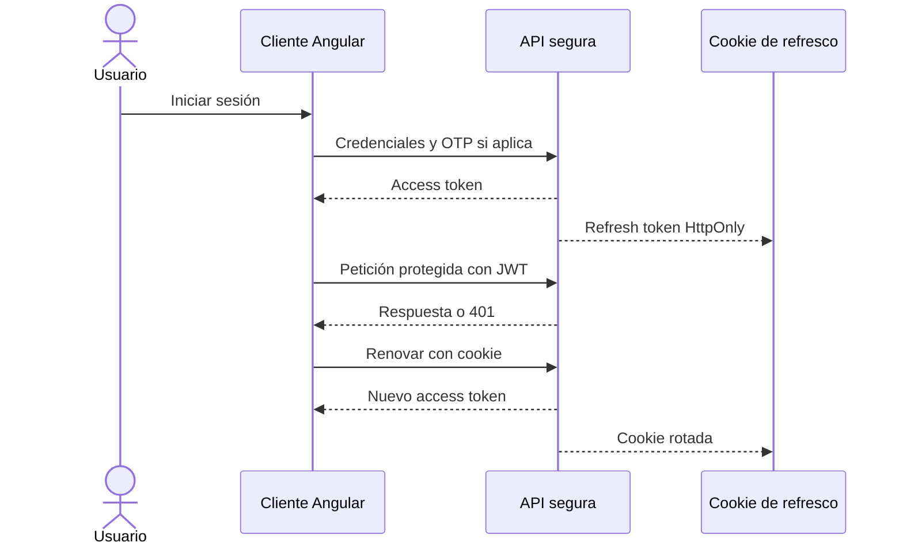

# Seguridad y sesión

## Descripción

Este módulo controla el acceso a la API y mantiene la sesión entre el navegador y el servidor. Incluye registro verificado, autenticación, segundo factor, renovación de credenciales y autorización por roles.

## Tecnologías

- Spring Security y JWT con JJWT.
- BCrypt para contraseñas y OTP de un solo uso.
- Angular, RxJS, guards e interceptores HTTP.

## Funcionamiento

El registro de estudiantes requiere verificar un código enviado por correo; la cuenta conserva además su estado de activación académica. En el inicio de sesión, la API comprueba la contraseña y el estado de la cuenta. Si el segundo factor está habilitado, solicita un OTP antes de completar la sesión.

La API emite un access token JWT de vida limitada y un refresh token aleatorio. El access token se conserva en memoria en el cliente; el refresh token se entrega en una cookie HttpOnly. La renovación rota el refresh token y revoca el anterior. Ante una respuesta 401, el interceptor intenta renovar la sesión y repetir una vez la solicitud original.

En cada petición protegida, Spring Security valida el JWT y contrasta el estado actual, rol y versión de tokens del usuario. Los guards ayudan a controlar la navegación, pero la autorización efectiva reside en el servidor. La recuperación de contraseña valida un OTP, cambia la contraseña y revoca las sesiones activas.

## Diagrama Mermaid

## Consideraciones técnicas

- La cookie de refresco usa atributos configurables; `Secure` depende del entorno y `SameSite` tiene un valor predeterminado restrictivo.
- La caché local del perfil permite mostrar contexto durante una desconexión, pero no valida una sesión ante la API.
- Los OTP expiran, limitan intentos y se consumen una sola vez; las rutas públicas y los límites de solicitudes son configurados por el backend.
