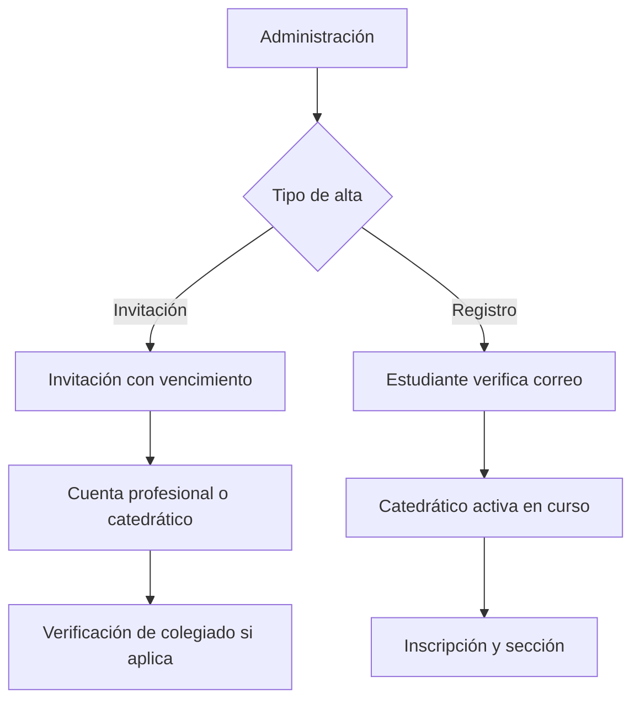

# Usuarios y cursos

## Descripción

Este módulo administra las cuentas y los vínculos académicos o profesionales que habilitan la participación en inspecciones y otras tareas del sistema.

## Tecnologías

- Spring Boot, Spring Data JPA y Bean Validation.
- PostgreSQL y Flyway.
- Angular y formularios reactivos.

## Funcionamiento

Un administrador puede invitar a usuarios con perfil de catedrático o profesional externo. La invitación se asocia a un token aleatorio con vencimiento; el destinatario valida el enlace y completa sus credenciales. Los profesionales registran su número de colegiado, que debe ser verificado por administración antes de habilitar las operaciones que lo requieren.

Los estudiantes se registran y verifican su correo, pero permanecen pendientes de activación. Un catedrático puede activar a un estudiante dentro de un curso activo que tenga asignado, indicando sección. La operación valida que el estudiante esté pendiente y no tenga ya una inscripción activa, y crea su inscripción académica.

Los cursos relacionan período, asignatura y catedrático. Administración puede crearlos, asignar o cambiar responsables y finalizarlos; las inscripciones vinculan estudiantes activos con curso y sección.

## Diagrama Mermaid

## Consideraciones técnicas

- La invitación no equivale a una sesión activa: el usuario debe completar el proceso de aceptación y establecer sus credenciales.
- La activación estudiantil depende de un curso vigente y de la asignación del catedrático; los roles y estados de cuenta se explican en el módulo de seguridad.
- La vigencia de inscripciones y colegiaturas es relevante para determinar qué operaciones académicas puede realizar cada usuario.
