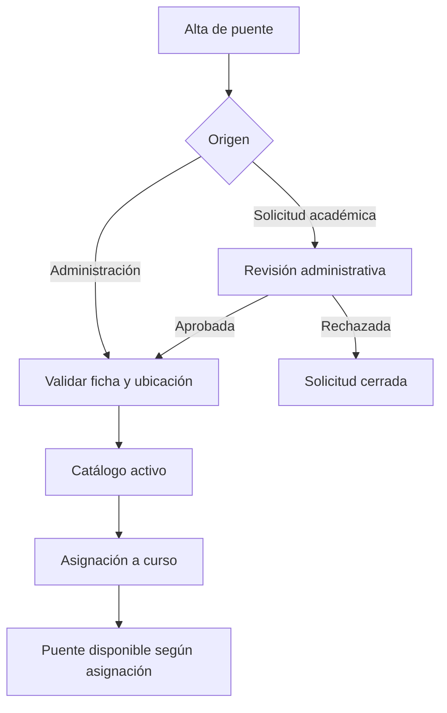

# Puentes y asignaciones

## Descripción

Este módulo mantiene el inventario de puentes, valida su ubicación y controla las solicitudes de alta y las asignaciones de trabajo a cursos.

## Tecnologías

- Spring Boot, Spring Data JPA e Hibernate Spatial.
- PostgreSQL con PostGIS y JTS.
- MapLibre GL en el cliente.

## Funcionamiento

El catálogo permite consultar puentes y su ubicación en mapa. Administración puede registrar o modificar fichas; un catedrático puede proponer un alta, que queda pendiente de decisión administrativa. Al guardar una ubicación se validan coordenadas dentro de Guatemala y su pertenencia al municipio seleccionado. Las consultas espaciales detectan puentes cercanos para advertir de posibles duplicados; la proximidad no bloquea automáticamente el alta y puede requerir confirmación.

Las asignaciones vinculan puentes activos con inscripciones académicas vigentes. El sistema impide duplicar una asignación activa y registra la revocación con su motivo. La selección disponible para trabajo de campo se deriva de estas asignaciones y del perfil del usuario.

## Diagrama Mermaid

## Consideraciones técnicas

- La ubicación se almacena como dato geográfico y se valida espacialmente contra límites municipales; no basta con validar latitud y longitud.
- La alerta de cercanía sirve para revisión de duplicados, no sustituye el criterio de aprobación.
- La revocación afecta la disponibilidad de una asignación para nuevas operaciones; el historial asociado al puente conserva su contexto.
