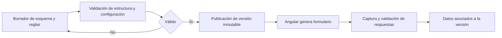

# Formularios y calibración

## Descripción

Este módulo define versiones de formularios técnicos y sus reglas de evaluación. El cliente construye la captura a partir del esquema publicado, mientras la configuración del IC se mantiene asociada a la versión.

## Tecnologías

- JSON Schema y validador JSON Schema en Spring.
- Angular Reactive Forms y RxJS.
- PostgreSQL con almacenamiento JSONB.

## Funcionamiento

Una versión de formulario se edita como borrador, se valida y luego se publica. El cliente resuelve el esquema y genera controles reactivos, incluidos campos repetibles y reglas de visibilidad condicional. Al guardar, serializa las respuestas visibles y aplica las validaciones derivadas del esquema.

La configuración de evaluación asociada incluye catálogo de elementos, mapeos entre versiones, escala, pesos y reglas críticas. Antes de publicar, el backend verifica que el esquema y la configuración sean coherentes y que los mapeos requeridos estén completos. La publicación calcula una huella del esquema y fija la versión activa; las inspecciones conservan referencia a la versión con la que fueron iniciadas. La calibración aprobada queda asociada a la versión y conserva su acta.

## Diagrama Mermaid

## Consideraciones técnicas

- El esquema de cada versión publicada no se modifica; permite interpretar inspecciones históricas con la estructura original.
- Formularios y reglas se versionan juntos para preservar la relación entre captura y cálculo. El algoritmo del IC se detalla en su propio módulo.
- Las referencias internas del JSON Schema se resuelven con límites de profundidad para evitar recursión indefinida.
- La aprobación de calibración es un proceso separado de la edición del borrador y conserva evidencia documental.
