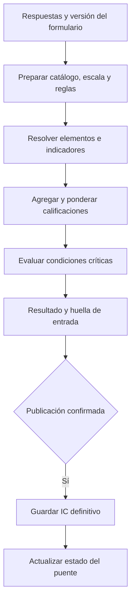

# Índice de condición

## Descripción

El módulo calcula el índice de condición (IC) de una inspección y, al publicarla, registra el resultado definitivo y actualiza el estado vigente del puente.

## Tecnologías

- Spring Boot, transacciones Spring y Jackson.
- PostgreSQL, JPA y consultas SQL para bloqueo transaccional.
- JSON Schema versionado y datos JSON de inspección.

## Funcionamiento

El cálculo toma los datos de inspección junto con el catálogo, los pesos, la escala y las reglas vinculadas a la versión del formulario. Resuelve los elementos evaluables y sus repeticiones, convierte las respuestas a calificaciones, agrega indicadores y aplica las reglas de ponderación y las condiciones críticas. Los elementos excluidos o marcados como no aplicables no participan; los datos requeridos ausentes generan un error de entrada incompleta. El resultado incluye desglose, estado calculado, versión del algoritmo y huella de los datos usados.

Antes de publicar, el sistema vuelve a preparar y calcular el IC definitivo con los datos persistidos. La confirmación permite aceptar el estado calculado o registrar un ajuste justificado cuando las reglas lo permiten. En una sola transacción se guarda el resultado de publicación y se actualiza el estado vigente del puente; un fallo revierte ambos cambios. El recálculo histórico conserva comparaciones y no reemplaza por sí mismo la publicación vigente.

## Diagrama Mermaid

## Consideraciones técnicas

- La configuración asociada a la inspección determina cómo interpretar sus respuestas; cambios en versiones posteriores no alteran el cálculo histórico.
- El valor preliminar sirve para revisión de captura; el definitivo se genera al publicar y se almacena junto con el desglose y la huella.
- El bloqueo del puente evita que publicaciones concurrentes compitan por actualizar su estado vigente.
- Los detalles de estados del ciclo de inspección y de revisión se describen en sus módulos respectivos.
