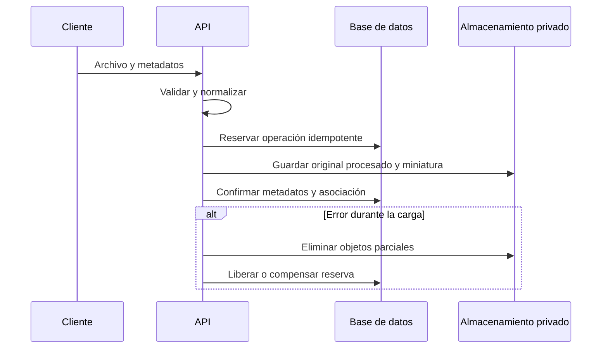

# Archivos y evidencias

## Descripción

Este módulo procesa, almacena y vincula fotografías y documentos con inspecciones, calibraciones y órdenes de mantenimiento.

## Tecnologías

- ImageIO y TwelveMonkeys ImageIO WebP.
- AWS SDK para S3 y almacenamiento local compatible con el proveedor configurado.
- Apache PDFBox para documentos PDF.
- PostgreSQL para metadatos y relaciones de archivos.

## Funcionamiento

Las fotografías se decodifican y normalizan a JPEG RGB; se genera una miniatura y un checksum. La imagen normalizada elimina metadatos EXIF del archivo almacenado, mientras los metadatos de captura que el flujo reconoce se registran por separado. El servicio guarda los objetos bajo claves privadas y asocia sus metadatos al dominio correspondiente. En inspecciones puede conservarse el anclaje a un elemento, instancia y categoría de evidencia.

La carga reserva primero una operación idempotente, almacena los objetos y luego confirma el registro del archivo y su asociación en la transacción del dominio. Si falla una etapa, intenta eliminar los objetos parciales y compensar la reserva. Los documentos se validan de acuerdo con su tipo de uso y el acceso de descarga se somete a autorización. El proveedor de objetos puede ser local o S3/MinIO según la configuración.

## Diagrama Mermaid

## Consideraciones técnicas

- Se valida el contenido decodificado, no solo la extensión o el MIME declarado; la normalización limita el lado mayor de la imagen a 1600 px y genera miniatura de 300 px.
- Base de datos y almacenamiento de objetos no comparten una transacción distribuida. Las reservas, compensaciones y procesos de recuperación reducen el riesgo de objetos huérfanos.
- Las claves de almacenamiento no deben tratarse como autorización: el servidor controla el acceso a las descargas.
- Los capítulos de inspección y mantenimiento describen los requisitos de evidencia de cada flujo; aquí se explica el mecanismo común de archivos.
