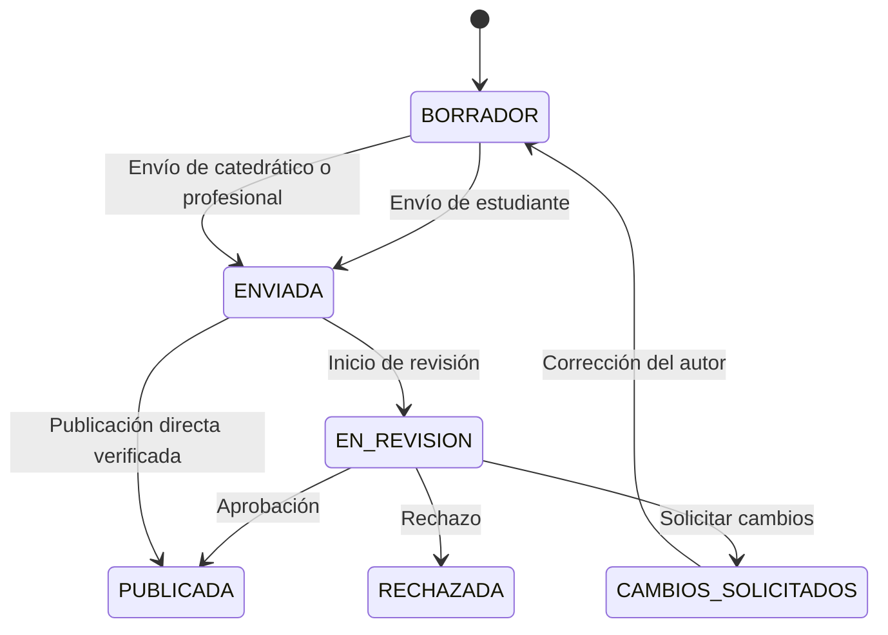

# Inspecciones

## Descripción

Este módulo coordina el ciclo de vida de una inspección: inicio, captura y guardado de respuestas, envío, publicación directa o revisión académica.

## Tecnologías

- Spring Boot, Spring Data JPA y Bean Validation.
- Angular y formularios reactivos generados desde esquemas.
- PostgreSQL con JSONB y control transaccional.

## Funcionamiento

Al iniciar, la inspección queda asociada a un puente, a su autor y a una versión concreta del formulario. La captura puede guardarse como borrador y se valida contra esa versión. Antes del envío o publicación se comprueban la completitud de respuestas y las evidencias requeridas para el flujo.

Las transiciones se validan como eventos desde un estado actual y se registran en el historial. Las inspecciones de estudiantes se envían a un ciclo de revisión de un catedrático; las de catedráticos y profesionales externos verificados pueden publicarse directamente. El revisor puede aprobar, solicitar cambios o rechazar, con motivo escrito para las dos últimas decisiones. Una corrección vuelve al autor para edición según el estado permitido. La publicación integra el IC definitivo en la transacción y emite un evento para procesos posteriores.

## Diagrama Mermaid

## Consideraciones técnicas

- La máquina de estados rechaza eventos incompatibles y los estados terminales no admiten nuevas transiciones.
- La concurrencia se controla al modificar la inspección; una solicitud incompatible puede devolver conflicto en lugar de sobrescribir cambios.
- Publicación, historial, IC definitivo y estado vigente del puente se confirman juntos. Las notificaciones y generación de mantenimiento ocurren en etapas posteriores.
- La sincronización offline y los detalles del cálculo, revisión y almacenamiento de evidencias se explican en sus capítulos propios.
