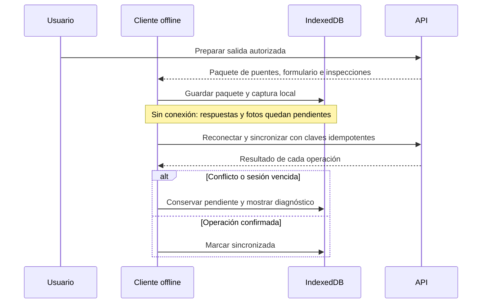

# Offline y sincronización

## Descripción

Este módulo permite preparar salidas de campo, conservar inspecciones y fotografías en el dispositivo y sincronizar las operaciones cuando vuelve la conectividad.

## Tecnologías

- Angular Service Worker (PWA) y Dexie sobre IndexedDB.
- API REST de sincronización e idempotencia en Spring.
- Almacenamiento del navegador y señales de conectividad.

## Funcionamiento

La API prepara un paquete de trabajo según el usuario, los puentes autorizados y la versión activa del formulario. El cliente guarda el paquete y los datos de campo localmente mediante la capa offline. IndexedDB conserva entidades pendientes y blobs de fotografía; el service worker administra la caché de recursos de la aplicación.

Cuando hay conexión, el sincronizador procesa las operaciones pendientes en orden: crea o actualiza el borrador, carga las fotografías y luego envía o publica la inspección. Cada operación conserva una clave idempotente para repetir solicitudes sin duplicar el efecto. La API vincula la clave con el usuario, método, ruta y huella de solicitud; si recibe la misma operación completada reproduce su respuesta, y rechaza reutilizarla con contenido distinto. Los conflictos de concurrencia quedan identificados para diagnóstico y resolución.

## Diagrama Mermaid

## Consideraciones técnicas

- Los datos locales se separan por propietario; cambiar de usuario no debe sincronizar pendientes de otra cuenta.
- Reintentar con la misma clave es seguro solo si se conserva la misma solicitud. La idempotencia no resuelve conflictos de edición concurrente.
- La cuota disponible depende del navegador y dispositivo; la estimación de almacenamiento no garantiza que futuras escrituras tengan éxito.
- El service worker cachea recursos de la app; no reemplaza IndexedDB como persistencia de los registros de campo.
