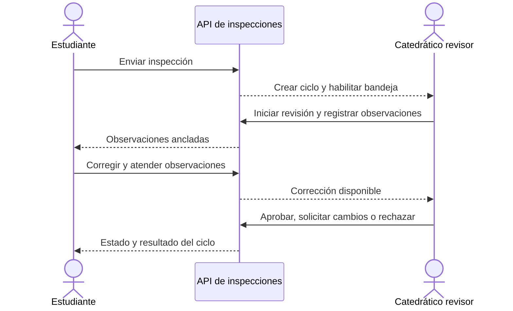

# Revisión académica

## Descripción

Este módulo gestiona la revisión de inspecciones estudiantiles, sus ciclos, observaciones y resolución por parte del catedrático.

## Tecnologías

- Spring Boot, Spring Data JPA y transacciones.
- Angular para bandejas, detalle y atención de observaciones.
- PostgreSQL para ciclos, observaciones e historial.

## Funcionamiento

Al enviar una inspección estudiantil se crea un ciclo de revisión asignado al catedrático correspondiente. El revisor consulta la bandeja, inicia el ciclo y revisa respuestas y evidencias. Puede anotar un elemento o instancia del formulario, una categoría fotográfica o una observación general. El backend valida que los anclajes existan en la versión del formulario y que la categoría corresponda al contexto.

El estudiante atiende las observaciones y remite la corrección; el revisor verifica su resolución y emite el veredicto del ciclo. La aprobación publica la inspección y coordina el cálculo definitivo del IC; solicitar cambios devuelve la inspección al autor y el rechazo la cierra. Los ciclos y estados se mantienen para conservar la trazabilidad de revisiones sucesivas.

## Diagrama Mermaid

## Consideraciones técnicas

- Solo el catedrático asignado puede resolver su ciclo; el autor y revisor deben ser distintos.
- La revisión se vincula a una versión concreta del formulario, por lo que los anclajes no dependen de la versión activa más reciente.
- La aprobación sigue las validaciones de completitud y evidencia de publicación; el detalle del IC definitivo está en su módulo.
- Las observaciones y correcciones se conservan por ciclo, evitando que una nueva revisión sobrescriba la anterior.
