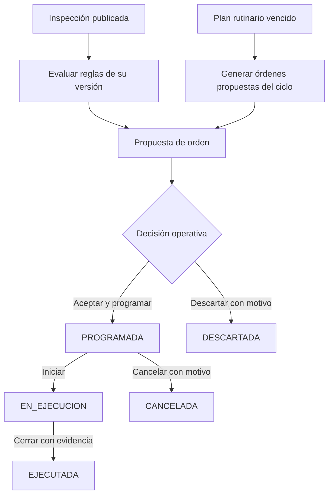

# Mantenimiento

## Descripción

Este módulo genera propuestas de mantenimiento desde inspecciones publicadas, administra planes rutinarios y controla órdenes hasta su ejecución.

## Tecnologías

- Spring Boot, Spring Data JPA y eventos transaccionales.
- PostgreSQL y JSONB para reglas y resultados.
- ShedLock para coordinar tareas programadas.

## Funcionamiento

Después de confirmarse la publicación de una inspección, un listener evalúa las reglas activas de la versión del formulario usada. Las condiciones se contrastan con los elementos inspeccionados y el resultado del IC; cada coincidencia puede generar una orden en estado `PROPUESTA`. La generación es idempotente y evita volver a proponer una orden equivalente que siga en curso. Administración puede regenerar propuestas faltantes.

Las propuestas no se aceptan ni programan automáticamente. Un usuario con permisos puede aceptarlas y programarlas, descartarlas con motivo, iniciar su ejecución o cancelarlas con motivo. El cierre como ejecutada exige datos de ejecución y evidencia. En paralelo, los planes rutinarios generan ciclos vencidos y órdenes asociadas; una tarea programada coordina ese trabajo con bloqueo distribuido.

## Diagrama Mermaid

## Consideraciones técnicas

- La generación automática ocurre después del commit de la publicación y en una transacción independiente: un error de mantenimiento no revierte una inspección ya publicada.
- Las órdenes generadas permanecen como propuestas hasta una decisión operativa; la prioridad sugerida y la evaluación de reglas no equivalen a programación.
- Los estados terminales no admiten nuevas transiciones; cambios de estado conservan historial.
- Las tareas programadas usan ShedLock para evitar ejecución concurrente entre instancias.
