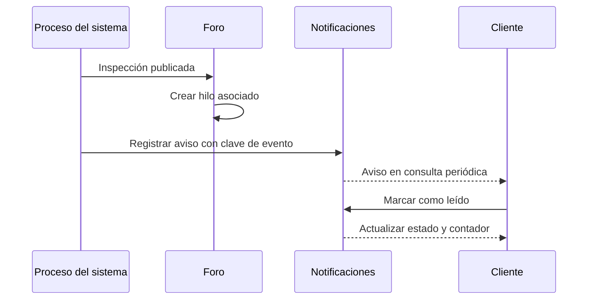

# Foro y notificaciones

## Descripción

Este módulo habilita la colaboración en torno a puentes e inspecciones publicadas y entrega avisos internos sobre eventos relevantes del sistema.

## Tecnologías

- Spring Boot, Spring Data JPA y eventos transaccionales.
- PostgreSQL para hilos, comentarios y notificaciones.
- Angular para consulta, contadores y avisos offline.

## Funcionamiento

El foro organiza hilos permanentes por puente y un hilo asociado a cada inspección publicada. Los comentarios permiten respuestas de un nivel; en el hilo de inspección pueden anclarse a un campo o elemento del formulario. La lectura es pública en los hilos disponibles, mientras que participar requiere sesión. Catedráticos y administradores pueden moderar comentarios y cerrar hilos; se aplican límites de participación.

La publicación de una inspección crea su hilo después de confirmar la transacción. Los comentarios y otras acciones del sistema pueden producir notificaciones internas para usuarios destinatarios. Cada aviso incluye una clave de evento para evitar duplicados y puede consultarse, marcarse como leído o resumirse por usuario. El cliente actualiza los avisos mediante consultas periódicas y conserva contexto de notificaciones para uso offline.

## Diagrama Mermaid

## Consideraciones técnicas

- El hilo asociado a una inspección se habilita solo después de su publicación; su creación ocurre después del commit.
- La validez de un anclaje depende del esquema de la inspección, no del formulario activo actual.
- La clave de evento evita duplicar avisos para el mismo usuario y evento; los textos también se validan para no incluir patrones de credenciales o calificaciones.
- Los avisos de la aplicación son persistentes e internos. Los correos de autenticación e invitación pertenecen a sus flujos respectivos.
