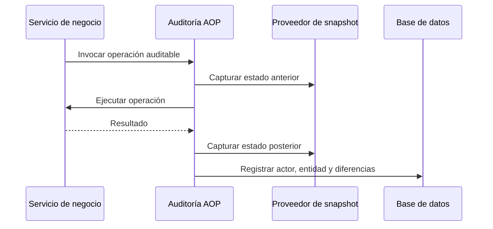

# Auditoría

## Descripción

La auditoría conserva cambios relevantes de negocio con actor, entidad, fecha y valores antes y después, y permite consultar la trazabilidad desde las herramientas administrativas.

## Tecnologías

- Spring AOP y anotaciones de auditoría.
- Spring Transactions y Spring Data JPA.
- Jackson para representar snapshots en JSON.

## Funcionamiento

Para operaciones anotadas, un aspecto obtiene el estado anterior mediante proveedores de snapshot, ejecuta la operación y captura el estado posterior. También existen escrituras explícitas desde servicios cuando una operación requiere registrar auditoría dentro de la misma transacción de negocio. Los procesos programados pueden registrar ejecuciones sin actor humano. La consulta administrativa presenta los registros y sus diferencias.

La escritura puede participar en la transacción existente o ejecutarse en una transacción independiente, según el tipo de registro. Los cambios que requieren atomicidad usan la transacción actual; otros registros se escriben con una frontera transaccional propia. Los logs operativos son un canal distinto y no reemplazan la bitácora persistente.

## Diagrama Mermaid

## Consideraciones técnicas

- La captura anterior/posterior depende de proveedores que proyectan datos del dominio; los snapshots no deben exponer secretos o información innecesaria.
- La propagación transaccional define si el registro acompaña al cambio o sobrevive a su rollback. Las llamadas explícitas deben respetar esa intención.
- Las fallas de captura se registran en logs y pueden dejar el snapshot incompleto; los logs no constituyen un reemplazo de la auditoría consultable.
- Los registros de tareas automáticas identifican el proceso y su resumen sin atribuirlo a un usuario.
