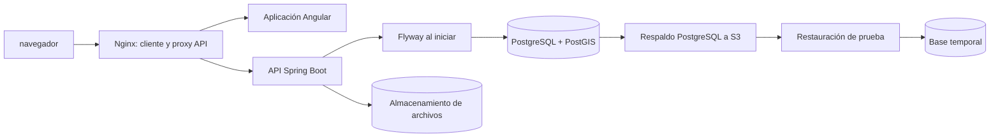

# Despliegue y recuperación

## Descripción

Este módulo describe la ejecución del cliente y la API junto con PostgreSQL/PostGIS, el manejo de configuración por entorno, el despliegue automatizado y la recuperación de datos.

## Tecnologías

- Java 21, Spring Boot y Maven.
- Angular, Node.js y Nginx.
- Docker Compose, PostgreSQL con PostGIS y Flyway.
- AWS S3 para objetos y respaldos en los perfiles de despliegue que lo configuran.

## Funcionamiento

Las imágenes de producción se construyen por separado para API y cliente. Nginx sirve la aplicación web y enruta las solicitudes API al backend; la API se conecta a PostgreSQL y al almacenamiento de archivos. Las variables y secretos se inyectan en ejecución. Flyway aplica las migraciones al iniciar la API mediante una cuenta de migración distinta de la cuenta de aplicación.

Los scripts de despliegue de staging y producción validan las imágenes candidatas y esperan health checks. El flujo de producción conserva la configuración anterior y puede restaurarla automáticamente si el despliegue falla. Los scripts de respaldo generan volcados de PostgreSQL y los almacenan en S3; el procedimiento de prueba restaura un respaldo en una base temporal y consulta migraciones y datos para comprobarlo.

## Diagrama Mermaid

## Consideraciones técnicas

- Los perfiles de ejecución requieren configurar URL y cuentas de base de datos, clave JWT, CORS, correo y almacenamiento; los valores de ejemplo no son secretos válidos.
- La cuenta de migración requiere permisos de esquema distintos de la cuenta de aplicación. Las migraciones aplicadas son parte del historial operativo.
- El rollback del despliegue restaura imágenes y composición previa; no revierte cambios de esquema de base de datos.
- La existencia de scripts de AWS, S3 o staging describe capacidad configurada en el proyecto y no demuestra que un ambiente esté desplegado o que una restauración haya sido ejecutada.
- La recuperación debe validarse periódicamente con restauraciones de prueba, no solo con la existencia de un archivo de respaldo.
