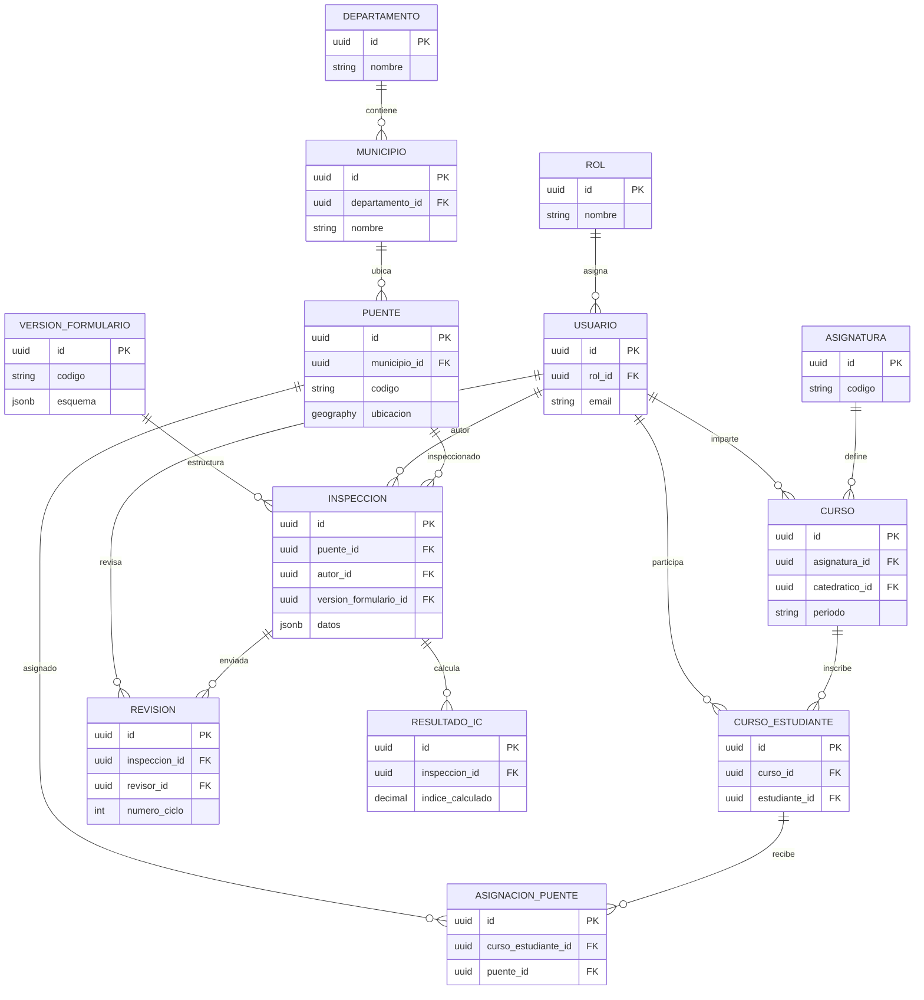

# Base de datos y relaciones principales

La persistencia usa PostgreSQL con PostGIS. Flyway versiona las modificaciones del esquema y Hibernate valida las entidades contra la estructura existente; la aplicación no crea tablas automáticamente. Las relaciones centrales conectan usuarios y cursos con puentes, inspecciones, revisiones y resultados técnicos.

La relación académica entre cursos, estudiantes y puentes se representa con entidades de asociación, lo que permite conservar sección, estado de inscripción y revocación de asignaciones. Una inspección conserva referencias a su puente, autor y versión de formulario. Puede generar varios resultados IC porque se registran publicaciones y recálculos; los ciclos de revisión se distinguen por número. El diagrama omite catálogos, archivos, bitácoras e historiales para facilitar su lectura.

Los datos espaciales de puentes se almacenan con PostGIS. El contenido variable de formularios y algunos desgloses se guarda en JSONB, mientras las relaciones y restricciones de integridad se expresan con claves foráneas, índices y restricciones de base de datos.
